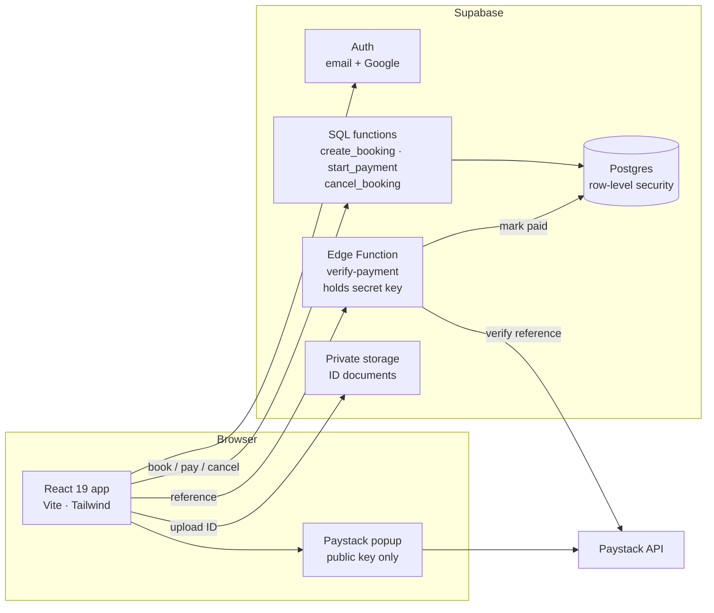
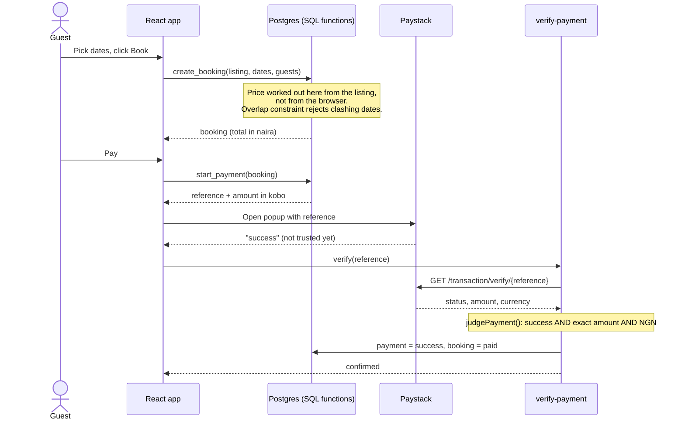

# Case study: Travel & Stays

**A two-sided booking marketplace for Nigeria, built during my MALhub internship (Aug–Oct 2026).**
Live: [travel-stays.vercel.app](https://travel-stays.vercel.app) · Code: this repo · Author: [Afolabi Peter](https://www.linkedin.com/in/afolabipeter-dev)

---

## The problem

Travellers in Nigeria book short stays mostly through WhatsApp and Instagram. They send money to a stranger and hope the apartment exists. Hosts have the opposite problem: no easy way to show they are legitimate, take payment in naira, or stop two people booking the same weekend.

The brief was a marketplace with three kinds of users (travellers, hosts and tour guides) where **money, dates and identity can be trusted**.

## What I built

- Search stays by city, dates and guests across all 36 states and the FCT, plus local tours
- Booking with a 10% service fee, host accept/decline or instant booking, and an availability calendar
- Paystack payments in naira (card, bank transfer, USSD), in test mode
- ID and selfie verification for hosts and guides, reviewed by an admin before the **Verified** badge appears
- Cancellation policies (flexible, moderate, strict) that quote the guest an exact refund before they cancel
- An admin dashboard with live "online now", sign-ups and revenue

## How it fits together



The browser never writes bookings or payments directly. It calls SQL functions that run the rules on the server, and the only thing that can mark a booking paid is the Edge Function.

## A booking, step by step



## The hard parts

### 1. Two guests, same weekend, same second
A check like "is the date free?" followed by an insert has a race: two requests can both see the dates free and both insert. I moved the guarantee into Postgres with an **exclusion constraint**:

```sql
constraint bookings_no_overlap exclude using gist (
  listing_id with =,
  daterange(check_in, check_out, '[)') with &&
) where (status in ('pending', 'confirmed'))
```

`'[)'` means check-out day is free for the next guest, and cancelled or declined bookings don't block anyone. The date picker greys out booked days for convenience, but the database is what makes a double booking impossible.

### 2. "The popup said success" is not proof
The Paystack popup runs in the browser, so anyone can fake its result. The `verify-payment` Edge Function asks Paystack directly, using a secret key that never leaves the server, and only accepts the payment if **all** of these hold: the request succeeded, Paystack says the transaction succeeded, the amount matches what the server priced **to the kobo**, and the currency is NGN.

That decision is a pure function (`supabase/functions/verify-payment/verify.ts`) with 11 unit tests that run in CI, including underpayment by one kobo, overpayment, wrong currency, abandoned popups, unknown references and malformed responses.

### 3. Prices come from the server
`create_booking` reads the nightly price and cleaning fee from the listing and computes nights, service fee and total in SQL. `start_payment` then charges exactly that total. A guest editing the page can change what they *see*, not what they *pay*.

### 4. Users can only touch their own rows
Every table has row-level security policies, and writes go through `security definer` functions that check `auth.uid()`. The rules hold even if someone skips the app and calls the Supabase API directly.

### 5. Trust before visibility
ID documents go to a private bucket that only admins can read. A host's listings show **Verified** only after an admin approves them, and any listing can be reported and paused immediately.

## Results

- Live on Vercel, with demo data scripts covering stays in all 36 states and the FCT, plus tours
- CI on every push: ESLint, production build and the payment tests
- Shipped through Git workflows and code reviews with the MALhub engineering team

## What I'd do next

- Hold host payouts until check-in using Paystack split payments and subaccounts. Today the platform records refunds for an admin to process.
- Database tests that prove the overlap constraint and RLS policies in CI, using the Supabase CLI
- Paystack webhooks as a second confirmation path, in case the guest closes the tab before verification runs
